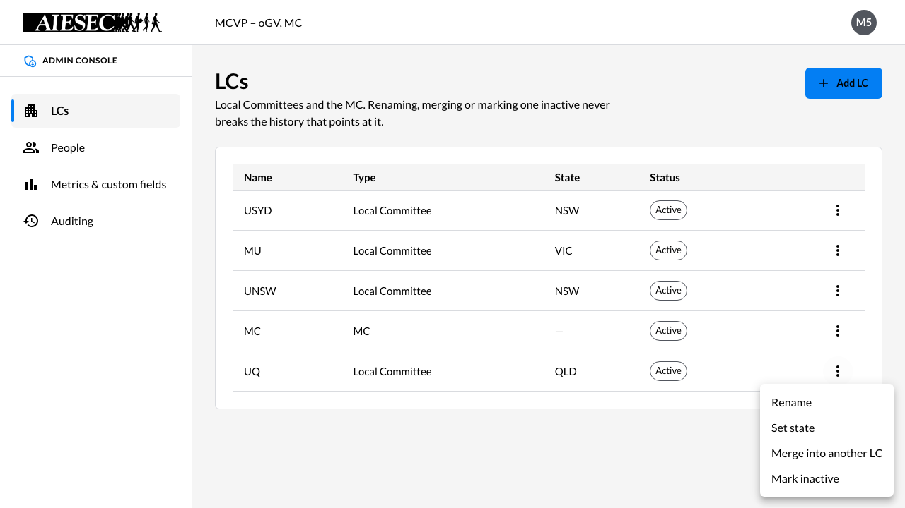
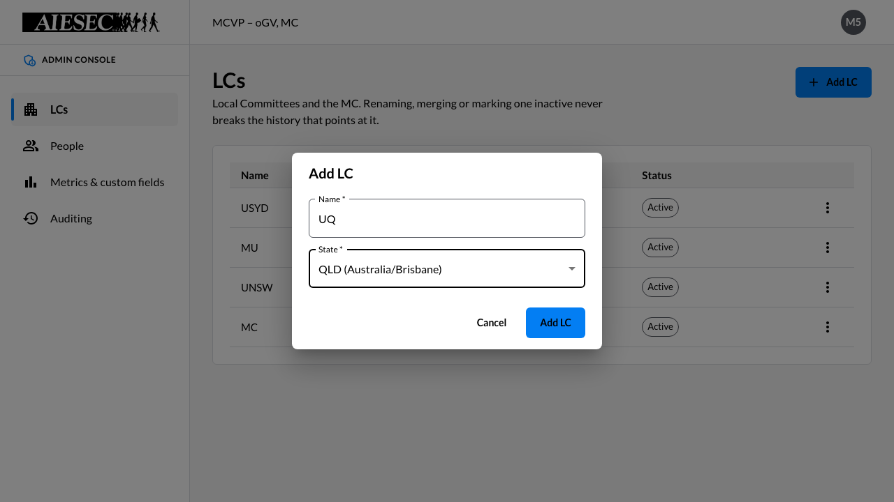
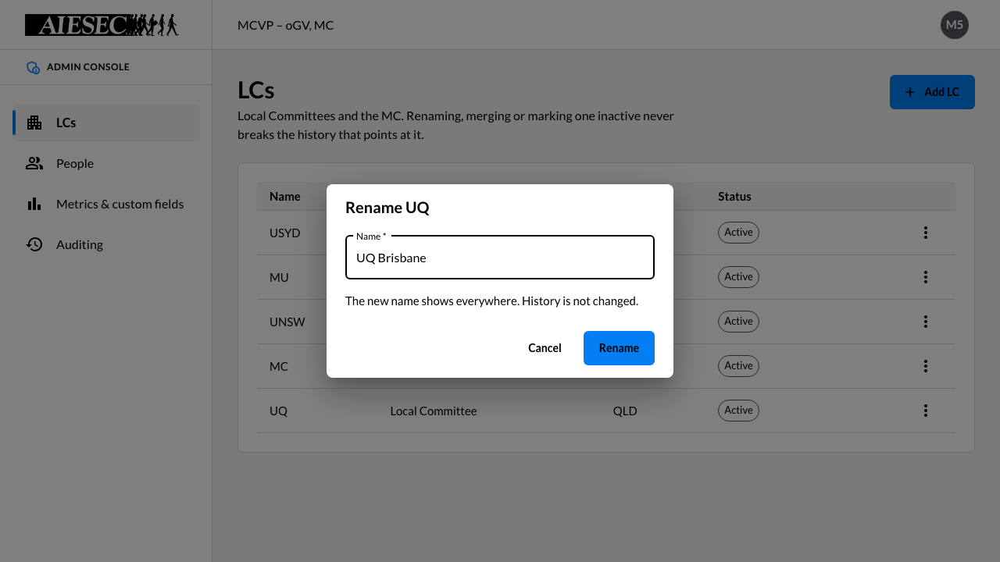
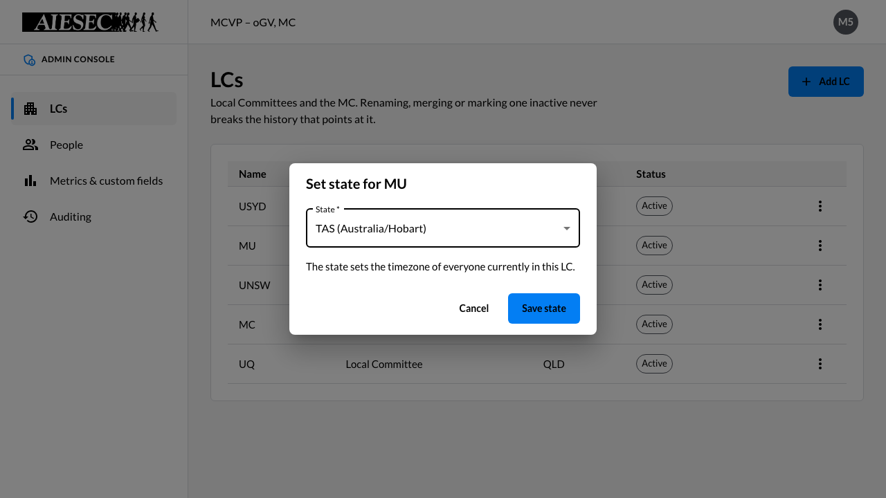
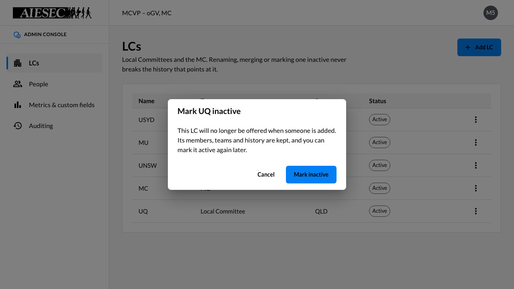
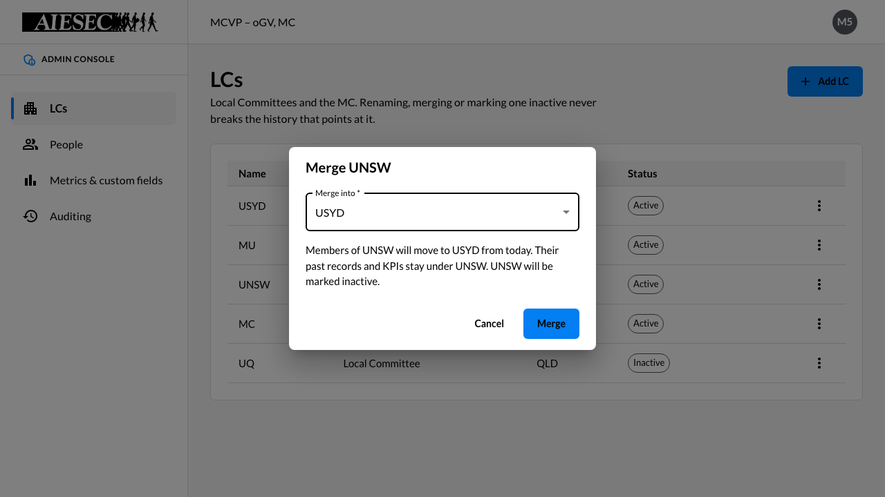
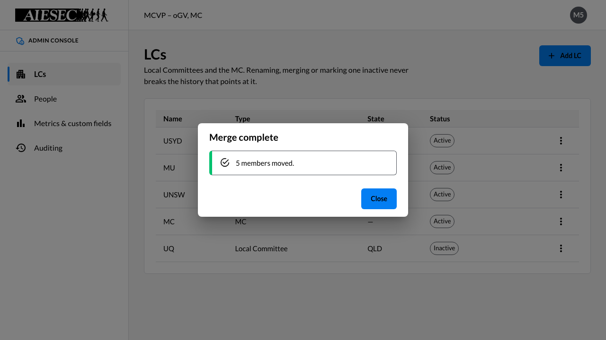
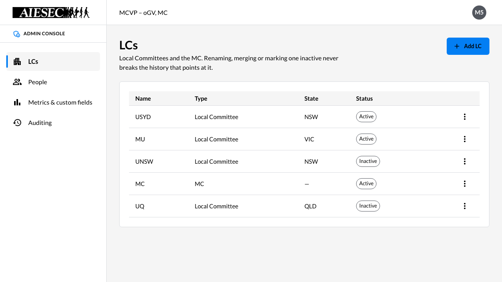

# 1. Managing LCs

**What this is for:** keeping the list of Local Committees (LCs) up to date: adding a
new LC, fixing its name or state, closing one that has stopped running, or combining two
LCs into one.

**Who can do this:** anyone on the MC, and anyone in an admin position.

**Where:** Admin console → **LCs**.

## Before you start

- **Nothing on this screen deletes an LC or anyone's history.** Renaming, marking
  inactive and merging all keep every past member, team and KPI where it was.
- **A merge can't be undone from the Admin console.** Read [Merge two LCs](#merge-two-lcs)
  fully before you do one. Every other action here can be reversed.
- Everything you do here is recorded in the audit log, with who did it and when.

## The LCs screen

Click **LCs** in the menu on the left. You'll see every LC, plus one row for the MC.

| Column | What it means |
|---|---|
| **Name** | The LC's name as everyone sees it in the tool. |
| **Type** | **Local Committee**, or **MC** for the national team. There is only one MC. |
| **State** | The Australian state the LC is in. The MC has none. |
| **Status** | **Active** LCs can have people added to them. **Inactive** ones are closed but kept for history. |

Every action for an existing LC is in its **⋮** menu at the end of its row. The menu
only shows the actions that make sense for that LC.

## Add an LC

Use this when a new LC starts running.

1. Click **Add LC** (top right).
2. Type the LC's **Name**. It must be different from every other LC, including inactive
   ones.
3. Choose its **State**. The time zone in brackets is filled in for you.
4. Click **Add LC**.

   

**Check it worked:** the new LC appears at the bottom of the list as **Active**.

The new LC has no people yet. Its LCP is added the same way as any other membership
(guide 2, not written yet).

## Rename an LC

Use this to fix a typo or when an LC changes its name. Every screen shows the new name
straight away, including for past terms.

1. In the LC's row, click **⋮**, then **Rename**.
2. Change the **Name**.
3. Click **Rename**.

   

You can rename it back at any time.

## Set an LC's state

Use this if an LC's state was entered wrong.

**Why the state matters:** the tool uses it to know the LC's time zone, and so when a day
starts and ends for its members. For example, a term that ends on 30 June ends at
midnight in Perth for a WA LC, not midnight in Sydney. Changing the state updates the
time zone of everyone currently in the LC.

1. In the LC's row, click **⋮**, then **Set state**.
2. Choose the new **State**.
3. Click **Save state**.

   

The MC has no state, so its menu has no **Set state**.

## Mark an LC inactive

Use this when an LC stops running. This is how an LC is "removed": it can't be deleted,
because its history (past members, teams, KPIs, reports) still points at it.

What changes: the LC is no longer offered when someone adds a person to the tool.

What doesn't change: its members, teams and history are all kept. **Marking an LC
inactive doesn't end anyone's membership.** If people in it should lose access, end
their memberships too.

1. In the LC's row, click **⋮**, then **Mark inactive**.
2. Read the message and click **Mark inactive**.

   

**Check it worked:** the LC's status shows **Inactive**.

### Undo: mark it active again

In the inactive LC's row, click **⋮**, then **Mark active**, and confirm. An inactive LC
can still be renamed or have its state set, but it can't be merged.

## Merge two LCs

Use this when one LC is joining another, so that its current members carry on in the
other LC. In these steps the LC that is closing is the **old LC**, and the one taking
its members is the **new LC**.

> **Warning: a merge can't be undone from the Admin console.** If you merge the wrong
> LCs, contact the tech team straight away. Check that both names are right before you
> click **Merge**.

What happens, from today:

- **Current members** of the old LC move to the new LC from today. They keep the same
  position, function and end date.
- **People who haven't started yet** in the old LC will start in the new LC instead.
- **Current teams** are copied to the new LC. If the new LC already has a team with the
  same name, in the same function and term, members join that team instead.
- **Past members, past teams and all KPIs stay with the old LC.** Reports for past terms
  don't change.
- **The old LC is marked inactive.**

Only active LCs can be merged, and the MC can't be merged.

1. In the **old LC's** row, click **⋮**, then **Merge into another LC**.
2. Under **Merge into**, choose the **new LC**.
3. Read the message. It names both LCs, so check they're the right way round.
4. Click **Merge**.

   

5. A summary shows how many members moved. Click **Close**.

   

**Check it worked:** the old LC now shows **Inactive**, and its current members appear
in the new LC's member list.

**If the summary mentions team leaders that were "not carried over":** a team in the
new LC already had a team leader, so the old LC's leader for that team joined as a
member instead. Each team keeps one leader. Check those teams and change the leader if
needed.

## If something goes wrong

| You see | What it means | What to do |
|---|---|---|
| "An LC with that name already exists." | Another LC, possibly an inactive one, already has that name. | Choose a different name. If the other LC is an inactive copy of the same LC, mark it active instead of adding a new one. |
| No **Add LC** button, or no **⋮** menus | Your position doesn't give you permission to manage LCs. | Ask someone on the MC to do it. |
| "You do not have permission to manage LCs" | Same as above, or your term ended while you were signed in. | Sign out and back in. If it still happens, ask someone on the MC. |
| The LC you want isn't offered under **Merge into** | You can only merge into an active LC (not the MC). | Mark it active first, then merge. |
| You merged the wrong LCs | — | Don't try to fix it by merging back. Contact the tech team straight away and tell them which LCs and roughly when. |

## Related guides

- Guide 2, adding people and memberships (not written yet): adding the LCP to a new LC.
- Guide 7, reading the audit log (not written yet): seeing who changed an LC and when.
